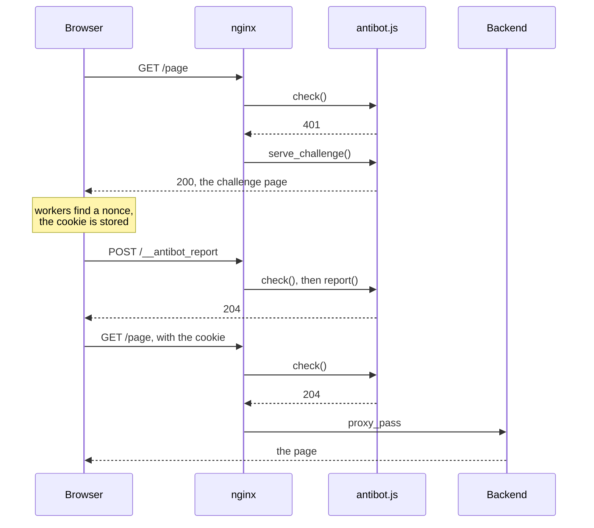
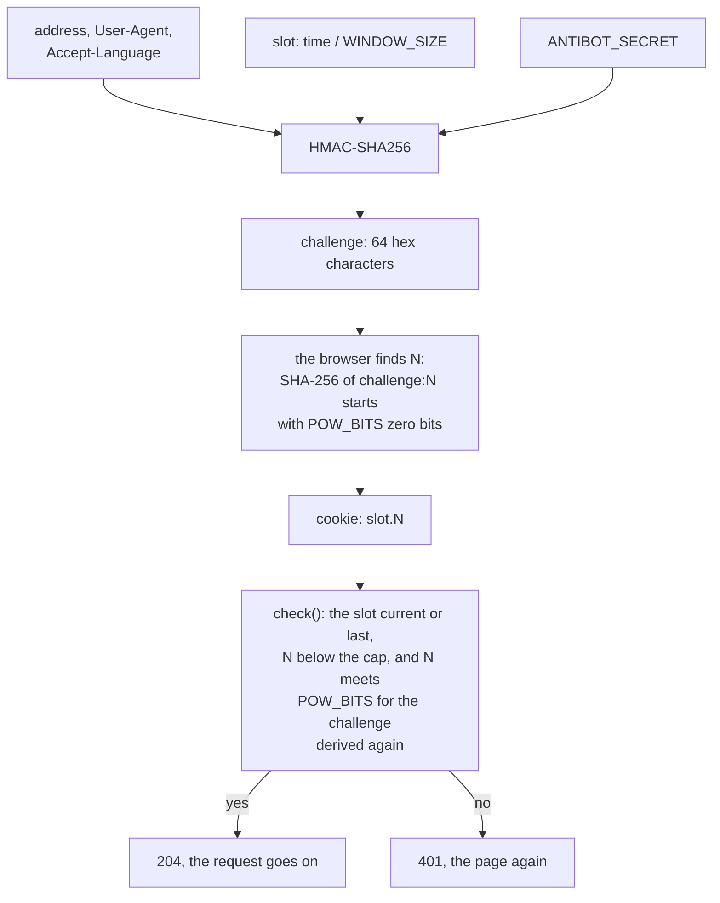
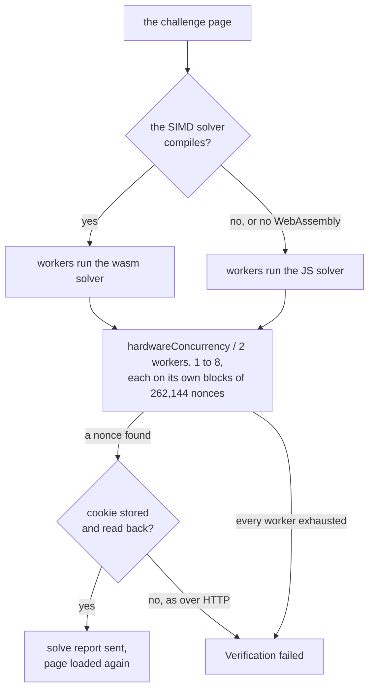

# How it works

nginx asks the module about every request to a gated route before the
backend sees it. A request carrying a valid cookie passes. Any other request
is answered with a page that finds a proof of work in the browser, stores it
as the cookie, and loads the page again. This page follows one visitor
through that, and links to the page that holds each part.

## A first visit

- **Two internal locations.** The gated catch-all names
  `auth_request /__antibot_check`, which calls `check()`, and
  `error_page 401 = /__antibot_challenge`, which calls `serve_challenge()`.
  The report location names the same `auth_request`.
  [Installation](installation.md#wiring) gives the wiring, and
  `examples/nginx.conf.example` all of it.
- **The status line.** A challenged request answers 200;
  [decisions](decisions.md#the-gate) says why, and what it costs a health
  check.
- **The report.** It reaches `report()` through the same `auth_request`, so
  only a request carrying the cookie just stored is counted;
  [configuration](configuration.md#the-solve-report) gives its arguments and
  counters.

## The challenge and the cookie

The module stores nothing per client. `check()` derives the challenge again
from the request and the secret, so any host with the same secret and
settings verifies a cookie another host issued
([installation](installation.md#requirements)). A cookie is bound to the
identity and the slot that produced it: [security](security.md#identity)
defines the identity, [design](design.md#the-algorithm) the hash and the
search, and [configuration](configuration.md#contract) the window and the
cap.

## In the browser

The workers share nothing, and the first nonce any of them finds wins.
[Design](design.md#the-worker-pool) explains the pool and both solvers,
[security](security.md#solver-rates) gives their rates, and
[configuration](configuration.md#difficulty) the mean wait at each difficulty.

## Where it sits

| A client | Where it is met |
|---|---|
| one that does not run JavaScript, or will not do the work | the gate: it never holds a cookie |
| one that does the work and then sends many requests | `limit_req`, keyed on what the operator chooses ([decisions](decisions.md#the-solvers)) |
| an operator with many addresses and the compute to solve for each | outside the gate ([security](security.md#what-the-gate-does-not-buy)) |
